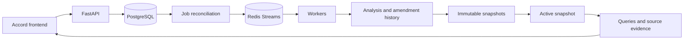

# Contract Intelligence Pipeline

A contract intelligence workspace for understanding agreements, following amendments, and tracing contract terms to their original sources.

The Accord interface brings an agreement library, historical terms, source evidence, and a review queue into one workspace. Upload documents, preview the resulting snapshot, and publish it when it is ready. Connected workspaces persist across page refreshes through an expiring HttpOnly session.

## Features

- **Agreement library:** search agreements, filter review status, and inspect eight extracted contract fields.
- **Amendment history:** apply clause and text replacements in effective-date order, with retained historical versions.
- **Source evidence:** inspect original passages alongside composite terms and amendment lineage.
- **Review workflow:** inspect conflicting changes, record decisions, and preview a new snapshot before publishing.
- **Evidence search:** retrieve accepted passages with BM25, character-trigram similarity, and reciprocal-rank fusion.
- **Structured queries:** count agreement families using typed predicates, with coverage and saved query receipts.
- **Durable processing:** PostgreSQL-backed jobs, lease ownership checks, retries, and Redis Streams delivery.
- **Atomic publication:** immutable snapshots, compare-and-swap promotion, and rollback to retained versions.

## Tech stack

| Layer | Technologies |
| --- | --- |
| Frontend | HTML, CSS, JavaScript modules, native dialogs |
| API | Python 3.12+, FastAPI, Pydantic, Uvicorn |
| Storage | PostgreSQL 17, psycopg |
| Processing | Redis Streams, background workers, database-backed job reconciliation |
| Document parsing | UTF-8 text, python-docx |
| Optional planner | OpenAI Responses API, structured outputs |
| Development | uv, pytest, Hypothesis, Ruff, mypy, Node.js test runner |
| Packaging | Docker Compose, GitHub Actions |

## Run locally

Install Docker with Compose and [uv](https://docs.astral.sh/uv/). Node.js 20+ runs the frontend tests.

```sh
git clone https://github.com/kashishdesai01/Contract-Intelligence-Pipeline.git
cd Contract-Intelligence-Pipeline
uv sync --frozen --python 3.12
docker compose -f deploy/compose.yaml up --build -d --scale worker=2
docker compose -f deploy/compose.yaml run --rm api cip create-tenant
```

Open [Accord](http://127.0.0.1:58080/), select **Connect workspace**, and enter the returned API key. The browser establishes an eight-hour session. Use **Disconnect** to end it.

The services run at:

| Service | Address |
| --- | --- |
| Frontend | http://127.0.0.1:58080/ |
| API explorer | http://127.0.0.1:58080/docs |
| PostgreSQL | localhost:55432 |
| Redis | localhost:56379 |

If your installation uses the standalone Compose binary, substitute `docker-compose` for `docker compose`.

### Try the workflow

1. Select **Add agreement** and upload [base.txt](examples/base.txt), or paste its text.
2. Preview the build and publish the snapshot.
3. Upload [amendment.txt](examples/amendment.txt), then preview and publish again.
4. Open the agreement: the current payment term is 60 days; the original version retains 30 days.
5. Select a term to inspect the supporting source passages.
6. Add [conflicting-amendment.txt](examples/conflicting-amendment.txt) to explore conflict review.

**Load sample set** submits the bundled example documents to the connected backend. **Explore the sample preview** opens a separate interactive preview. See [input format](docs/supported-inputs.md) for document structure and [frontend workflow](docs/frontend.md) for navigation.

### Command-line demo

With the database and Redis running:

```sh
uv run cip demo
uv run cip eval
```

The demo creates an isolated tenant and processes synthetic agreements. Outputs are written under `artifacts/`.

## Architecture



PostgreSQL stores source bytes, job state, artifacts, snapshots, and query receipts. Redis delivers work hints. Workers renew leases and validate ownership in the transaction that commits their results. A snapshot captures its source manifest at build time; publication atomically updates the active snapshot for a tenant.

See [architecture](docs/architecture.md) and [operations](docs/runbook.md).

## Configuration

Docker Compose supplies local development defaults. Set these variables through your environment or a local `.env` file:

| Variable | Purpose |
| --- | --- |
| `POSTGRES_PASSWORD` | PostgreSQL migration account password |
| `CIP_RUNTIME_PASSWORD` | Application database role password |
| `DATABASE_URL` | Database connection for locally run CLI/API processes |
| `REDIS_URL` | Redis connection for locally run CLI/API processes |
| `OPENAI_API_KEY` | Credentials for the optional live planner |
| `CIP_MODEL` | Model revision for the optional live planner |

The optional planner translates a question into a validated count, lookup, or search operation. Enable it with `OPENAI_API_KEY` and `CIP_MODEL`, then call `/v1/ask` with `mode: "live"`. Document ingestion and structured queries run directly through the deterministic pipeline.

## Development

```sh
uv run ruff check src tests scripts
uv run ruff format --check src tests scripts
uv run mypy src scripts
CIP_INTEGRATION=1 uv run pytest -q
node --test tests/frontend.test.mjs
```

The integration suite uses the local PostgreSQL and Redis services. Run it with container workers stopped so tests can control job ownership:

```sh
docker compose -f deploy/compose.yaml stop worker
CIP_INTEGRATION=1 uv run pytest -q
docker compose -f deploy/compose.yaml up -d --scale worker=2 worker
```

To exercise the running API:

```sh
uv run python scripts/api_smoke.py
uv run python scripts/benchmark.py
```

See [evaluation](docs/evaluation.md) for the synthetic corpus and grading workflow.

## License

[MIT](LICENSE).
